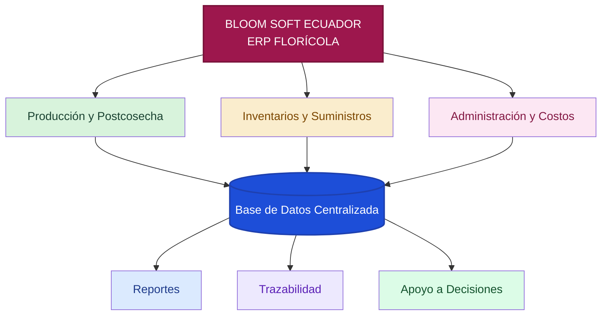

 

# 🌹 BLOOM SOFT ECUADOR

### *Sistema ERP para la gestión integral de la producción florícola*

  

  

> **Cultivamos innovación, conectamos procesos y transformamos datos en decisiones.**

---

## 🌸 SOBRE EL PROYECTO

**BLOOM SOFT ECUADOR** es una propuesta de **sistema ERP** orientada a empresas florícolas, diseñada para integrar en una sola plataforma los procesos de:

- 🌱 Producción y postcosecha  
- 📦 Inventarios y suministros  
- 💰 Administración y costos  
- 📊 Reportes gerenciales  
- 🔎 Trazabilidad de operaciones  

El objetivo es reemplazar los registros manuales por una solución digital centralizada que mejore el control, la organización y la toma de decisiones.

---

## ✨ PROPUESTA DE VALOR

| 🌹 Integración | 📊 Control | 🔍 Trazabilidad | 🚀 Eficiencia |
|:--:|:--:|:--:|:--:|
| Un solo sistema para toda la operación | Datos organizados y disponibles | Seguimiento de procesos e insumos | Menos tareas manuales |

---

## 🎯 OBJETIVO GENERAL

Desarrollar un prototipo funcional de un sistema ERP que permita integrar, administrar y controlar los procesos de producción, inventarios y administración de una empresa florícola, mejorando la eficiencia operativa y la toma de decisiones.

---

## 🧩 MÓDULOS DEL SISTEMA

<table>
<tr>
<td width="33%" valign="top">

### 🌱 Producción y Postcosecha
- Registro de tallos cosechados  
- Producción por bloque y variedad  
- Clasificación de rosas  
- Consulta de disponibilidad  
- Reportes diarios  

</td>
<td width="33%" valign="top">

### 📦 Inventarios y Suministros
- Registro de fertilizantes y fungicidas  
- Entradas y salidas de inventario  
- Consumo por bloque  
- Alertas de stock mínimo  
- Historial de movimientos  

</td>
<td width="33%" valign="top">

### 💰 Administración y Costos
- Registro de actividades laborales  
- Cálculo de trabajo a destajo  
- Costos de mano de obra e insumos  
- Rentabilidad por variedad  
- Reportes gerenciales  

</td>
</tr>
</table>

---

## 🚨 PROBLEMÁTICAS IDENTIFICADAS

| Problema | Descripción |
|---|---|
| 📄 Pérdida de información | Los registros físicos pueden deteriorarse en ambientes húmedos. |
| ⏱️ Retrasos en postcosecha | El proceso manual retrasa clasificación y empaquetado. |
| 📦 Falta de control de inventario | No existe un registro digital inmediato del consumo de insumos. |
| 💸 Desconocimiento de costos | Se dificulta conocer la rentabilidad real por variedad. |
| 🔎 Problemas de trazabilidad | El seguimiento de tratamientos y procesos es manual. |

---

## 🏗️ ARQUITECTURA CONCEPTUAL

---

## 🧠 SISTEMAS DE INFORMACIÓN RELACIONADOS

| Sistema | Función en el proyecto |
|---|---|
| **TPS** | Registro de transacciones diarias: cosechas, clasificación y movimientos de inventario. |
| **MIS** | Generación de reportes de producción, costos y existencias. |
| **DSS** | Apoyo a decisiones mediante análisis de rentabilidad y consumo de insumos. |
| **ERP** | Integración total de módulos y procesos mediante una base de datos compartida. |

---

## 🌷 VISTA VISUAL DEL PROYECTO

---

## 📈 BENEFICIOS ESPERADOS

- ✅ Información centralizada y organizada  
- ✅ Mayor control de producción e inventarios  
- ✅ Seguimiento detallado de procesos  
- ✅ Mejor análisis de costos y rentabilidad  
- ✅ Apoyo a la toma de decisiones gerenciales  
- ✅ Reducción de errores por manejo manual  

---

## 👥 EQUIPO DE DESARROLLO

| Integrante | Rol |
|:---:|:---:|
| **Matías Aguilera** | Integrante del proyecto |
| **Daniel Pillajo** | Integrante del proyecto |
| **Martin Villavicencio** | Integrante del proyecto |

---

## 🎓 INFORMACIÓN ACADÉMICA

| Campo | Detalle |
|---|---|
| **Asignatura** | Fundamentos de Sistemas de Información |
| **Proyecto** | BLOOM SOFT ECUADOR |
| **Tipo** | Sistema ERP |
| **Sector** | Florícola |
| **País** | Ecuador |
| **Año** | 2026 |

---

## 🗺️ HOJA DE RUTA

- [x] Definición del proyecto  
- [x] Identificación de problemáticas  
- [x] Identificación de áreas del ERP  
- [x] Definición del alcance funcional  
- [ ] Diseño de interfaces  
- [ ] Diseño de base de datos  
- [ ] Desarrollo del prototipo  
- [ ] Integración de módulos  
- [ ] Pruebas del sistema  
- [ ] Presentación final  

---

## 💚 VISIÓN DEL PROYECTO

> Crear una solución tecnológica que ayude a modernizar la industria florícola ecuatoriana mediante información centralizada, procesos más eficientes y una mejor capacidad de decisión.

---

### 🌹 BLOOM SOFT ECUADOR
**Cultivando tecnología para el sector florícola**

