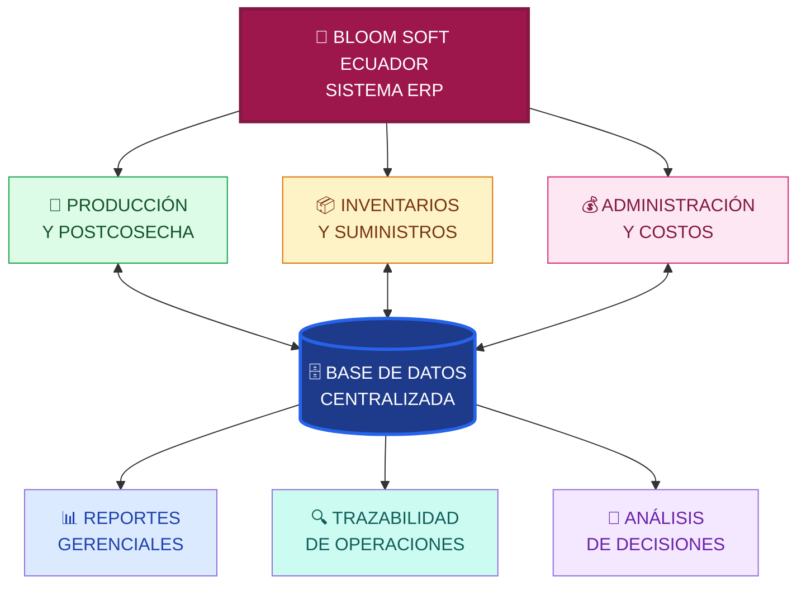
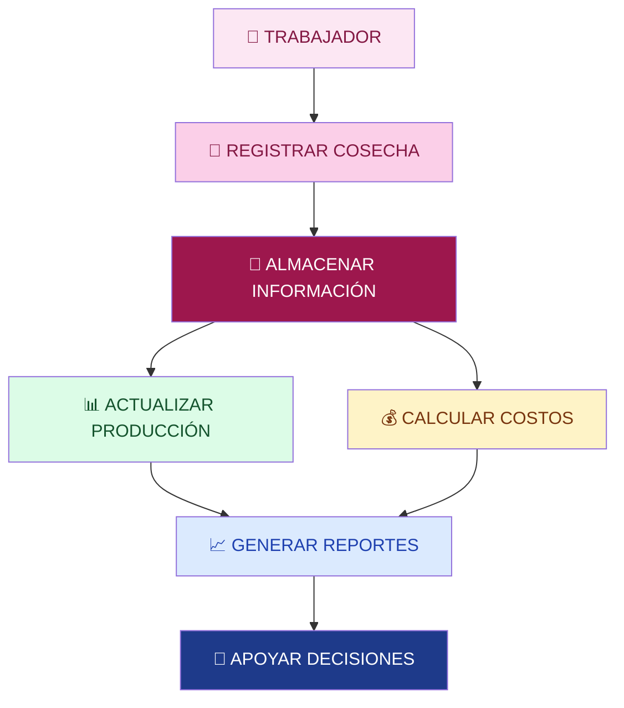

# 🌹 BLOOM SOFT ECUADOR

### 🌸 Cultivamos innovación, cosechamos tecnología 🌸

**Sistema ERP para la gestión integral y trazabilidad de la producción florícola**

 

*Digitalizando la industria de las rosas, conectando procesos y transformando datos en decisiones inteligentes.*

---

**[🌹 Sobre el proyecto](#-sobre-el-proyecto) • [🧩 Módulos](#-módulos-del-sistema) • [🏗️ Arquitectura](#️-arquitectura-del-sistema) • [👨‍💻 Equipo](#-nuestro-equipo)**

 

# 🌹 Sobre el proyecto

**BLOOM SOFT ECUADOR** es una propuesta tecnológica enfocada en el desarrollo de un **Sistema de Planificación de Recursos Empresariales (ERP)** para empresas dedicadas a la producción, clasificación y comercialización de rosas.

Nuestro propósito es transformar la gestión florícola tradicional mediante una plataforma digital que integre los procesos operativos y administrativos en un solo lugar.

El proyecto se desarrolla sobre el caso de una empresa florícola ficticia ecuatoriana que comercializa rosas para mercados nacionales e internacionales.

### 💡 Nuestra propuesta de valor

> 🌱 **De registros manuales a decisiones inteligentes.**
>
> Una plataforma centralizada que conecta producción, inventarios, trabajadores y costos para mejorar la eficiencia, la trazabilidad y el control empresarial.

 

### 🌷 El futuro de la gestión florícola es digital

---

# 🎯 Objetivos del proyecto

### 🚀 Objetivo general

Desarrollar un prototipo funcional de un sistema ERP que permita integrar, administrar y controlar los procesos de producción, inventarios y administración de una empresa florícola, facilitando la trazabilidad, la eficiencia operativa y la toma de decisiones gerenciales.

### 🎯 Objetivos específicos

- 🌹 Digitalizar el registro de cosecha y clasificación de rosas.
- 🌱 Controlar la producción por bloque, variedad y trabajador.
- 📦 Administrar las entradas, salidas y existencias de insumos.
- 💰 Integrar información de producción y gastos.
- 👷 Registrar actividades y productividad del personal.
- 📊 Generar reportes operativos y gerenciales.
- 🔍 Facilitar la trazabilidad de insumos y actividades.
- 🧠 Apoyar las decisiones empresariales mediante información organizada.

---

# 🚨 ¿Qué problemas buscamos solucionar?

La industria florícola depende de numerosos procesos que requieren información precisa y actualizada.

Cuando esta información se administra manualmente, aparecen problemas que afectan la productividad y la rentabilidad.

| 🚨 Problemática | 📋 Situación actual | ✅ Solución propuesta |
|:---|:---|:---|
| 📄 Pérdida de información | Los registros físicos pueden deteriorarse por la humedad de los invernaderos. | Digitalización y almacenamiento centralizado. |
| ⏰ Retrasos en postcosecha | La clasificación manual retrasa el procesamiento y empaquetado. | Registro digital de clasificación. |
| 📦 Descontrol de inventarios | No existe información inmediata del consumo de productos agrícolas. | Control digital de entradas, salidas y consumo. |
| 💸 Costos desconocidos | Dificultad para determinar la rentabilidad de cada variedad. | Integración de costos y producción. |
| 🔍 Trazabilidad limitada | Los reportes fitosanitarios requieren procesos manuales. | Historial digital de operaciones y tratamientos. |

### 🌟 Nuestra solución

**UN SISTEMA • TRES ÁREAS • INFORMACIÓN CENTRALIZADA**

---

# 🏢 Nuestro sistema ERP

Un **ERP (Enterprise Resource Planning)** es un sistema de información que integra diferentes áreas de una organización mediante procesos conectados y una base de datos compartida.

BLOOM SOFT ECUADOR busca implementar este concepto en el sector florícola.

| 🌱 PRODUCCIÓN | 📦 INVENTARIOS | 💰 ADMINISTRACIÓN |
|:---:|:---:|:---:|
| Cosecha de rosas | Registro de insumos | Gestión de trabajadores |
| Control por bloques | Entradas y salidas | Costos de producción |
| Clasificación | Control de existencias | Análisis de rentabilidad |
| Reportes diarios | Alertas de stock | Reportes gerenciales |

### 🔗 ¿Cómo se relacionan los procesos?

Cuando un trabajador registra una cosecha, la información puede utilizarse para conocer la producción del bloque, registrar su actividad y calcular los costos correspondientes.

Cuando se utiliza un fungicida, el sistema debe registrar el consumo, actualizar el inventario y relacionar el tratamiento con el bloque correspondiente.

**Esta integración es lo que convierte nuestra solución en un ERP y no solamente en un sistema de registros.**

---

# 🧩 Módulos del sistema

## 🌱 Módulo 01 — Producción y postcosecha

Este módulo se encargará de registrar y controlar las operaciones relacionadas con la producción de rosas.

**⚙️ Funcionalidades previstas**

- ✅ Registro de tallos cosechados por trabajador.
- ✅ Control de producción por bloque.
- ✅ Gestión de variedades de rosas.
- ✅ Registro de clasificación.
- ✅ Consulta de rosas disponibles.
- ✅ Reportes diarios de producción.

**📊 Información generada**

Cantidad de rosas cosechadas, producción por trabajador, rendimiento por bloque y disponibilidad de rosas.

---

## 📦 Módulo 02 — Inventarios y suministros

Permitirá administrar los suministros necesarios para el cultivo y mantenimiento de las rosas.

**⚙️ Funcionalidades previstas**

- ✅ Registro de fertilizantes y fungicidas.
- ✅ Control de entradas al inventario.
- ✅ Control de salidas del inventario.
- ✅ Registro del consumo por bloque.
- ✅ Alertas de existencias mínimas.
- ✅ Historial de movimientos de productos.

**📊 Información generada**

Disponibilidad de suministros, consumo de productos químicos y movimientos de inventario.

---

## 💰 Módulo 03 — Administración y costos

Este módulo permitirá relacionar la información operativa con los costos y resultados de la empresa.

**⚙️ Funcionalidades previstas**

- ✅ Registro de actividades de trabajadores.
- ✅ Control de producción individual.
- ✅ Cálculo de valores por trabajo a destajo.
- ✅ Consulta de costos de mano de obra.
- ✅ Control de costos de insumos.
- ✅ Análisis de rentabilidad por variedad.
- ✅ Generación de reportes gerenciales.

**📊 Información generada**

Costos operativos, productividad del personal y análisis económico de la producción.

---

# 🏗️ Arquitectura del sistema

### 🔄 Diagrama conceptual de integración

**Nota:** El diagrama representa la arquitectura conceptual propuesta. La arquitectura técnica definitiva se establecerá durante el desarrollo del prototipo.

---

# 🧠 Sistemas de información integrados

BLOOM SOFT ECUADOR contempla la aplicación de cuatro conceptos fundamentales de los sistemas de información empresariales.

| Sistema | Significado | Aplicación en BLOOM SOFT |
|:---:|---|---|
| 🔄 **TPS** | Transaction Processing System | Registro de cosechas, clasificación y movimientos de inventario. |
| 📊 **MIS** | Management Information System | Generación de reportes de producción, costos y existencias. |
| 🧠 **DSS** | Decision Support System | Análisis de rentabilidad, consumo de insumos y resultados productivos. |
| 🏢 **ERP** | Enterprise Resource Planning | Integración de las áreas mediante información centralizada. |

### 🔄 Ejemplo de funcionamiento

### 📌 Flujo de consumo de inventario

---

# 👥 Usuarios del sistema

El prototipo contempla accesos diferenciados según las responsabilidades de los usuarios.

| 👤 Usuario | 🎯 Responsabilidad |
|---|---|
| 👨‍🌾 Personal de producción | Registrar cosechas y actividades productivas. |
| 🌹 Personal de postcosecha | Registrar la clasificación de rosas. |
| 📦 Encargado de inventarios | Controlar existencias y movimientos de insumos. |
| 🧑‍💼 Administración | Consultar costos y actividades laborales. |
| 📊 Gerencia | Revisar reportes e indicadores para tomar decisiones. |

Los permisos y las funciones concretas de cada rol se definirán durante el diseño del prototipo.

---

# 🎨 Diseño de la aplicación

## 🖥️ Interfaces del prototipo

La aplicación se plantea con una interfaz sencilla, organizada y accesible para los diferentes tipos de usuario.

### 🏠 Pantalla principal

Panel de acceso a los módulos de producción, inventarios y administración.

### 🌱 Gestión de producción

Formulario para registrar cosechas y consultar los resultados productivos.

### 📦 Control de inventarios

Interfaz para administrar insumos, movimientos y existencias.

### 📊 Panel de reportes

Visualización de información de producción, costos y recursos.

> 📸 **Próximamente:** En esta sección se incorporarán las capturas reales de las interfaces desarrolladas.

---

# 📈 Indicadores propuestos

Los reportes del ERP permitirán consultar indicadores relevantes para la gestión empresarial.

| 🌹 PRODUCCIÓN | 📦 INVENTARIO |
|:---:|:---:|
| Tallos cosechados | Insumos disponibles |
| Rendimiento por bloque | Consumo de productos |
| Producción por variedad | Movimientos registrados |

| 👷 PERSONAL | 💰 COSTOS |
|:---:|:---:|
| Producción por trabajador | Costo de mano de obra |
| Actividades realizadas | Costo de insumos |
| Trabajo a destajo | Rentabilidad por variedad |

---

# 🌟 Beneficios esperados

| Beneficio | Descripción |
|---|---|
| 🚀 Eficiencia | Menor dependencia de registros y procesos manuales. |
| 🔐 Organización | Información centralizada y accesos diferenciados. |
| 🌱 Productividad | Mejor seguimiento de las operaciones florícolas. |
| 📦 Control | Seguimiento de suministros y existencias. |
| 💰 Rentabilidad | Información para analizar costos de producción. |
| 🔍 Trazabilidad | Registro histórico de actividades y tratamientos. |
| 📊 Información | Reportes para supervisar las operaciones. |
| 🧠 Decisiones | Análisis de información para apoyar a la gerencia. |

---

# 🗺️ Hoja de ruta

### 🚧 Estado actual: Propuesta y planificación

### 📋 Etapas del proyecto

- [x] Selección de la empresa y del sector.
- [x] Definición del proyecto ERP.
- [x] Identificación de problemáticas.
- [x] Identificación de las áreas de negocio.
- [x] Definición de funcionalidades propuestas.
- [x] Identificación de TPS, MIS, DSS y ERP.
- [ ] Diseño de interfaces.
- [ ] Diseño de la base de datos.
- [ ] Desarrollo del módulo de producción.
- [ ] Desarrollo del módulo de inventarios.
- [ ] Desarrollo del módulo administrativo.
- [ ] Integración de módulos.
- [ ] Generación de reportes.
- [ ] Pruebas de funcionamiento.
- [ ] Presentación del prototipo final.

### 🔄 Ciclo de desarrollo previsto

---

# 🛠️ Tecnologías

Las tecnologías de implementación se definirán durante el desarrollo del prototipo.

El proyecto contempla los siguientes componentes técnicos:

- 💻 Interfaz gráfica para los usuarios.
- ⚙️ Lógica de negocio de los módulos ERP.
- 🗄️ Base de datos compartida.
- 🔐 Accesos diferenciados por usuario.
- 📊 Generación y consulta de reportes.

Esta sección se actualizará con los lenguajes, frameworks, herramientas y motores de bases de datos utilizados realmente.

---

# 👨‍💻 Nuestro equipo

### 🌹 Las personas detrás de BLOOM SOFT ECUADOR

| 👨‍💻 Integrante | 🎓 Participación |
|:---:|:---:|
| **Matías Aguilera** | Equipo de desarrollo |
| **Daniel Pillajo** | Equipo de desarrollo |
| **Martin Villavicencio** | Equipo de desarrollo |

 

**Tres integrantes, una visión: desarrollar tecnología que aporte valor al sector florícola ecuatoriano.**

---

# 🎓 Información académica

| 📚 Información | 📋 Detalle |
|---|---|
| **Universidad** | Pontificia Universidad Católica del Ecuador |
| **Asignatura** | Fundamentos de Sistemas de Información |
| **Nombre del proyecto** | BLOOM SOFT ECUADOR |
| **Tipo de proyecto** | Sistema Integrado de Gestión Florícola |
| **Categoría** | ERP |
| **Sector empresarial** | Florícola |
| **País** | Ecuador 🇪🇨 |
| **Año académico** | 2026 |
| **Integrantes** | Matías Aguilera, Daniel Pillajo y Martin Villavicencio |

---

# 📚 Conceptos fundamentales

### 🌹 ERP — Enterprise Resource Planning

Sistema que integra recursos, información y procesos de una organización.

### 🔄 TPS — Transaction Processing System

Sistema encargado del procesamiento de las transacciones operativas diarias.

### 📊 MIS — Management Information System

Sistema que proporciona información y reportes útiles para la administración.

### 🧠 DSS — Decision Support System

Sistema de apoyo a decisiones mediante análisis y comparación de información.

---

# 💬 Nuestra visión del proyecto

> 🌹 *Imaginamos una industria florícola donde cada rosa cosechada, cada recurso utilizado y cada actividad realizada pueda convertirse en información valiosa para construir empresas más eficientes, organizadas y competitivas.*

BLOOM SOFT ECUADOR busca demostrar cómo la integración de los sistemas de información puede transformar la administración de una empresa florícola.

---

# 🌹 BLOOM SOFT ECUADOR 🌹

### 🌱 Cultivando innovación, cosechando el futuro.

**Transformamos datos en información.**
  
**Transformamos información en decisiones.**
  
**Transformamos decisiones en oportunidades.**

 

 

**⭐ Gracias por visitar nuestro proyecto ⭐**

**© 2026 BLOOM SOFT ECUADOR**

*Proyecto académico — Fundamentos de Sistemas de Información*

**Hecho con 💚 y pasión por la tecnología.**

