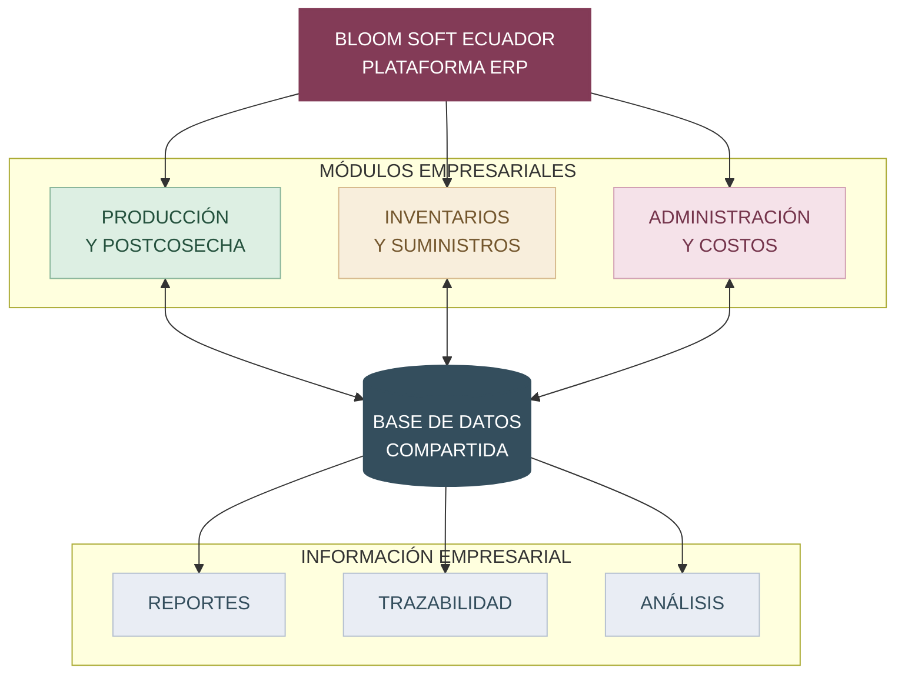
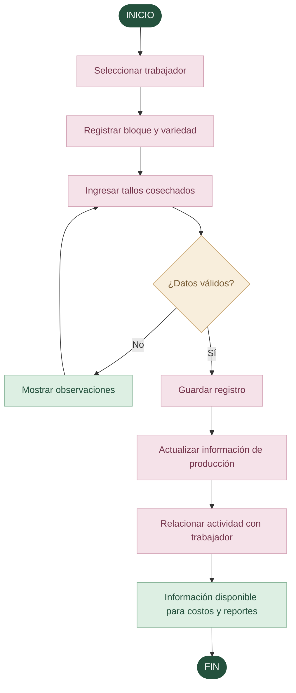
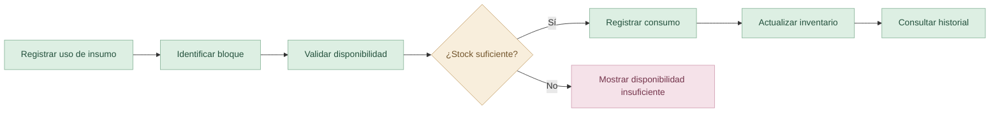
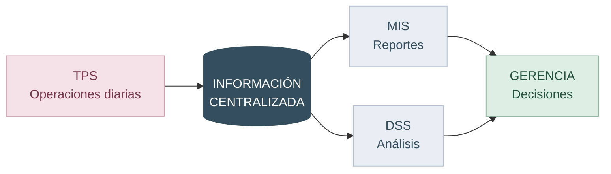

 

 

**SISTEMA INTEGRADO DE GESTIÓN FLORÍCOLA**

Una nueva forma de entender, organizar y transformar la producción de rosas.

  

&nbsp;

&nbsp;

&nbsp;

  

<a href="#el-proyecto">El proyecto</a>
&nbsp;&nbsp; · &nbsp;&nbsp;
<a href="#módulos-del-erp">Módulos</a>
&nbsp;&nbsp; · &nbsp;&nbsp;
<a href="#arquitectura-y-flujo">Arquitectura</a>
&nbsp;&nbsp; · &nbsp;&nbsp;
<a href="#nuestro-equipo">Equipo</a>

  

LA NATURALEZA INSPIRA. LA TECNOLOGÍA TRANSFORMA.

 

---

 

01 / NUESTRA ESENCIA

# El proyecto

### Tecnología que florece con cada proceso.

**Bloom Soft Ecuador** es una propuesta de sistema ERP (*Enterprise Resource Planning*) diseñada para integrar la gestión operativa y administrativa de una empresa florícola.

El proyecto nace de una necesidad: **transformar los procesos manuales en una experiencia digital integrada, organizada y confiable**.

A través de una plataforma centralizada, buscamos relacionar la producción de rosas, el uso de suministros, las actividades del personal y los costos de producción, convirtiendo las operaciones diarias en información útil para la empresa.

 

> [!IMPORTANT]
> **Nuestra propuesta**
>
> Unificar las áreas de producción, inventarios y administración mediante una base de datos compartida, reduciendo la duplicación de información y facilitando el control de los recursos florícolas.

 

| UNA PLATAFORMA | TRES ÁREAS | UN MISMO PROPÓSITO |
|:---:|:---:|:---:|
| Información centralizada | Producción, inventarios y costos | Mejor gestión empresarial |

 

---

 

02 / NUESTRA DIRECCIÓN

# Visión del producto

### Cada rosa tiene una historia. Cada dato, un propósito.

<table>
<tr>
<td width="50%" valign="top">

### Nuestra misión tecnológica

Proponer una solución digital que integre los procesos de una empresa florícola, facilitando el registro de operaciones, el control de recursos y la generación de información para la gestión empresarial.

</td>
<td width="50%" valign="top">

### Nuestra visión tecnológica

Construir un prototipo de ERP que demuestre cómo la digitalización y la integración de información pueden impulsar una industria florícola más organizada, eficiente y orientada a los datos.

</td>
</tr>
</table>

### Objetivo general

Desarrollar un prototipo funcional de un sistema ERP para integrar los procesos de producción, inventarios y administración de una empresa florícola, mejorando la eficiencia operativa, la trazabilidad y la toma de decisiones.

### Objetivos específicos

- Digitalizar la información de cosechas y postcosecha.
- Organizar la producción por trabajador, bloque y variedad.
- Centralizar los registros de inventario y consumo de insumos.
- Facilitar el cálculo de costos de producción.
- Generar reportes operativos y gerenciales.
- Mejorar la trazabilidad de las actividades florícolas.

 

---

 

03 / EL DESAFÍO

# ¿Por qué nace Bloom Soft?

### Grandes resultados comienzan resolviendo problemas reales.

En las empresas florícolas, los registros manuales pueden provocar retrasos, errores, pérdida de información y dificultades para analizar los costos reales de producción.

Nuestro proyecto busca atender cinco necesidades fundamentales.

 

|  | Desafío actual | Nuestra respuesta |
|:---:|---|---|
| 01 | **Pérdida de información** por deterioro de registros físicos en ambientes húmedos. | Digitalización de registros. |
| 02 | **Retrasos en postcosecha** durante la clasificación y el procesamiento de rosas. | Registro organizado de clasificación. |
| 03 | **Falta de control de inventarios** y del consumo de insumos agrícolas. | Seguimiento de entradas, salidas y existencias. |
| 04 | **Dificultad para conocer costos** y rentabilidad por variedad de rosa. | Integración de costos y producción. |
| 05 | **Trazabilidad limitada** de tratamientos y operaciones productivas. | Historial digital de actividades. |

 

DE LOS REGISTROS MANUALES A LA INFORMACIÓN INTELIGENTE

 

---

 

04 / NUESTRO ECOSISTEMA

# Módulos del ERP

### Tres áreas conectadas. Una solución integral.

 

<table>
<tr>
<td width="33%" valign="top" align="center">

<h3>01</h3>
<h3>🌱 Producción</h3>

<strong>Y POSTCOSECHA</strong>

  

Registro de cosechas

 

Control por bloques

 

Variedades de rosas

 

Clasificación de tallos

 

Disponibilidad

 

Reportes diarios

</td>
<td width="33%" valign="top" align="center">

<h3>02</h3>
<h3>📦 Inventarios</h3>

<strong>Y SUMINISTROS</strong>

  

Registro de insumos

 

Entradas y salidas

 

Consumo por bloque

 

Existencias

 

Alertas de stock

 

Historial de movimientos

</td>
<td width="33%" valign="top" align="center">

<h3>03</h3>
<h3>📊 Administración</h3>

<strong>Y COSTOS</strong>

  

Actividades del personal

 

Trabajo a destajo

 

Costos de mano de obra

 

Costos de insumos

 

Rentabilidad por variedad

 

Reportes gerenciales

</td>
</tr>
</table>

 

### 🌱 Producción y postcosecha

El primer módulo permitirá registrar las operaciones realizadas durante la cosecha y el procesamiento de rosas.

**Información principal**

| Entrada | Procesamiento | Resultado |
|---|---|---|
| Trabajador, bloque, variedad y tallos | Registro y organización de producción | Producción diaria y disponibilidad |

### 📦 Inventarios y suministros

El segundo módulo gestionará fertilizantes, fungicidas y otros recursos empleados durante la producción.

**Información principal**

| Entrada | Procesamiento | Resultado |
|---|---|---|
| Insumos y movimientos | Control de entradas, salidas y consumo | Existencias e historial |

### 💰 Administración y costos

El tercer módulo relacionará las actividades operativas con los gastos y resultados económicos.

**Información principal**

| Entrada | Procesamiento | Resultado |
|---|---|---|
| Actividades, producción y costos | Integración de datos administrativos | Costos y análisis de rentabilidad |

 

---

 

05 / DISEÑO DEL SISTEMA

# Arquitectura y flujo

### Todo está conectado.

Nuestro ERP propone una arquitectura conceptual basada en tres módulos integrados a través de una base de datos centralizada.

### 01 — Arquitectura general

FIGURA 01 · ARQUITECTURA CONCEPTUAL PROPUESTA

 

### 02 — Flujo de registro de cosecha

FIGURA 02 · FLUJO FUNCIONAL PROPUESTO PARA EL REGISTRO DE COSECHA

 

### 03 — Flujo de control de suministros

FIGURA 03 · FLUJO CONCEPTUAL PARA CONSUMO DE INSUMOS

 

### 04 — Integración de sistemas de información

FIGURA 04 · RELACIÓN CONCEPTUAL ENTRE TPS, MIS Y DSS

 

> [!NOTE]
> Los diagramas representan el comportamiento y la estructura conceptual prevista para el prototipo. Su implementación técnica se definirá durante el desarrollo.

 

---

 

06 / INTELIGENCIA EMPRESARIAL

# Más que un ERP

### Información que impulsa decisiones.

El sistema busca integrar diferentes tipos de sistemas de información empresariales en una misma solución.

| Sistema | Propósito | Aplicación |
|---|---|---|
| **TPS** | Procesamiento de transacciones | Registro de cosechas, clasificación y movimientos. |
| **MIS** | Información administrativa | Reportes de producción, costos e inventarios. |
| **DSS** | Apoyo a decisiones | Análisis de rentabilidad, consumo y productividad. |
| **ERP** | Planificación de recursos empresariales | Integración de procesos y datos compartidos. |

 

**REGISTRAR → INTEGRAR → ANALIZAR → DECIDIR**

 

---

 

07 / EXPERIENCIA DEL USUARIO

# Diseño del prototipo

### Simple por fuera. Integrado por dentro.

La aplicación se propone con una interfaz sencilla, intuitiva y organizada, con accesos diferenciados según las funciones de cada usuario.

### Pantallas previstas

<table>
<tr>
<td width="50%" valign="top">

**01 — Panel principal**

Acceso organizado a los módulos del ERP y consulta de información relevante.

</td>
<td width="50%" valign="top">

**02 — Gestión de producción**

Registro y consulta de cosechas, bloques y variedades.

</td>
</tr>
<tr>
<td valign="top">

**03 — Control de inventarios**

Administración de suministros, movimientos y existencias.

</td>
<td valign="top">

**04 — Reportes gerenciales**

Consulta de indicadores productivos, operativos y económicos.

</td>
</tr>
</table>

> [!TIP]
> **Galería del prototipo**
>
> Cuando se encuentren desarrolladas las interfaces, se incorporarán aquí capturas reales del sistema, incluyendo el panel principal, los formularios y los reportes.

 

---

 

08 / EL IMPACTO

# Beneficios esperados

### Una organización más conectada.

| Beneficio | Valor para la empresa |
|---|---|
| **Digitalización** | Disminuir la dependencia de documentos físicos. |
| **Integración** | Compartir información entre diferentes áreas. |
| **Productividad** | Facilitar el seguimiento de las operaciones. |
| **Trazabilidad** | Conservar un historial organizado de actividades. |
| **Control** | Conocer las existencias y el consumo de insumos. |
| **Análisis** | Relacionar producción, recursos y costos. |
| **Decisiones** | Proporcionar información para la gestión gerencial. |

 

---

 

09 / EVOLUCIÓN DEL PROYECTO

# Hoja de ruta

### De la idea a una solución funcional.

| Etapa | Actividad | Estado |
|---|---|:---:|
| 01 | Definición del tema y la empresa | ✅ |
| 02 | Identificación de las problemáticas | ✅ |
| 03 | Determinación de las áreas del ERP | ✅ |
| 04 | Definición de funcionalidades propuestas | ✅ |
| 05 | Identificación de TPS, MIS, DSS y ERP | ✅ |
| 06 | Diseño de las interfaces | ⬜ |
| 07 | Diseño de la base de datos | ⬜ |
| 08 | Desarrollo de los módulos | ⬜ |
| 09 | Integración y generación de reportes | ⬜ |
| 10 | Pruebas y presentación final | ⬜ |

### Flujo de desarrollo previsto

 

---

 

10 / LAS PERSONAS DETRÁS DE LA IDEA

# Nuestro equipo

### Tres personas. Una visión compartida.

<table>
<tr>
<td align="center" width="33%">

 

<strong>Matías Aguilera</strong>

INTEGRANTE DEL PROYECTO

</td>
<td align="center" width="33%">

 

<strong>Daniel Pillajo</strong>

INTEGRANTE DEL PROYECTO

</td>
<td align="center" width="33%">

 

<strong>Martin Villavicencio</strong>

INTEGRANTE DEL PROYECTO

</td>
</tr>
</table>

*Un equipo comprometido con el aprendizaje, el desarrollo de software y la aplicación de tecnología a situaciones empresariales.*

 

---

 

11 / CONTEXTO ACADÉMICO

# Información del proyecto

| | |
|---|---|
| **Universidad** | Pontificia Universidad Católica del Ecuador |
| **Carrera** | Ingeniería en Sistemas |
| **Asignatura** | Fundamentos de Sistemas de Información |
| **Proyecto** | Bloom Soft Ecuador |
| **Enfoque** | Sistema integrado de gestión florícola |
| **Modelo** | ERP |
| **Industria** | Producción y comercialización de rosas |
| **País** | Ecuador |
| **Año** | 2026 |

 

---

 

12 / NUESTRA FILOSOFÍA

# Tecnología que florece.

 

  

### *Cada proceso cuenta.*
### *Cada recurso importa.*
### *Cada dato tiene valor.*

 

Creemos que la innovación tecnológica no solamente consiste en crear software, sino en desarrollar soluciones que permitan a las organizaciones comprender mejor sus procesos.

**Bloom Soft Ecuador** representa nuestra propuesta para conectar la tecnología con la producción florícola y demostrar la importancia de los sistemas de información en la gestión empresarial.

 

  

 

**BLOOM SOFT ECUADOR**

PROYECTO ACADÉMICO · FUNDAMENTOS DE SISTEMAS DE INFORMACIÓN · 2026

 

**Diseñado con dedicación, creatividad y pasión por la tecnología.**

 

© 2026 Bloom Soft Ecuador

